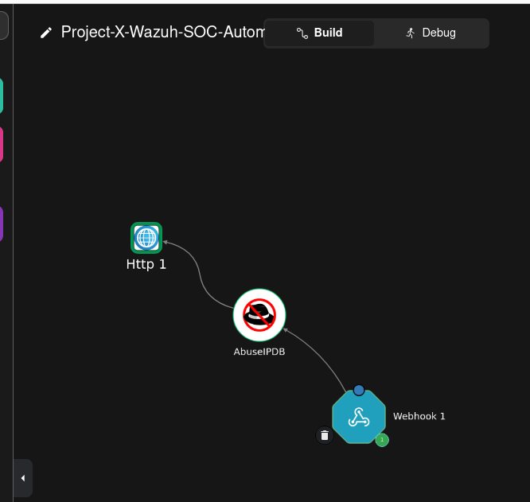
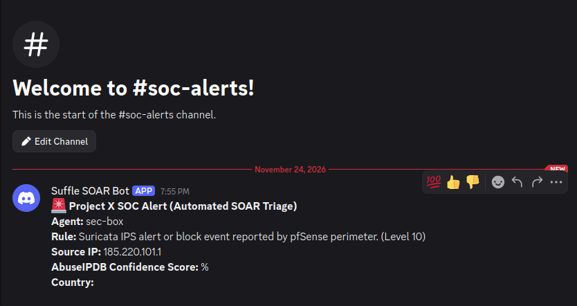
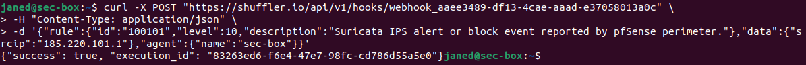

# Cloud-Based SOC Automation: Automated Alert Enrichment & SOAR Triage Pipeline

## Overview
This project extends a locally hosted **Wazuh SIEM** into a hybrid, **Cloud-Based SOAR (Security Orchestration, Automation, and Response)** pipeline using permanently free and open-source cloud services. Whenever a high-severity alert (`level >= 7`) fires on-premises, Wazuh dispatches a JSON webhook outbound over HTTPS to **Shuffle Cloud**, which automatically enriches attacker indicators via **AbuseIPDB** and delivers formatted, analyst-ready incident alerts to a dedicated **Discord `#soc-alerts`** channel in under five seconds—with zero inbound router ports exposed.

[Read the Full Technical Breakdown on Medium](https://medium.com/@pompey.lamont01/from-raw-telemetry-to-automated-triage-building-a-zero-cost-enterprise-siem-cloud-soar-pipeline-d47e139d11f6?sharedUserId=pompey.lamont01)

---

## Architecture & Automated Data Flow

```text
[ Wazuh Manager (sec-box / 10.0.0.10) ]
       │
       │  1. High-Severity Alert (Level >= 7, JSON over Outbound HTTPS)
       ▼
[ Shuffle Cloud SOAR (Webhook Trigger) ]
       │
       │  2. Extract $exec.data.srcip & Query Reputation API
       ▼
[ AbuseIPDB API (Threat Intelligence Enrichment) ]
       │
       │  3. Return Confidence Score (%) & Geolocation (Country Code)
       ▼
[ Shuffle HTTP POST Node ]
       │
       │  4. Deliver Formatted Incident Brief (HTTP 204)
       ▼
[ Discord #soc-alerts Channel (Real-Time SOC Notification) ]
```

### Zero-Cost Enterprise Stack

| Component | Platform | Cost | Function |
| :--- | :--- | :--- | :--- |
| **SIEM Engine** | Wazuh Manager (sec-box) | Open-Source (\$0) | Detects threats and triggers outbound webhooks via `wazuh-integratord` |
| **Cloud SOAR** | Shuffle Cloud (shuffler.io) | Free Tier (\$0) | Orchestrates webhook ingestion, API enrichment, conditional triage, and routing |
| **Threat Intel** | AbuseIPDB API | Free Tier (\$0) | Automates IP reputation scoring and geolocation enrichment |
| **Alerting** | Discord Webhooks (#soc-alerts) | Free (\$0) | Delivers real-time, structured incident briefs to SOC analysts |

---

## Configuration & Playbook Logic

### 1. Wazuh Outbound Webhook Integration (`/var/ossec/etc/ossec.conf`)
Configured Wazuh's native `shuffle` integrator with a severity threshold of `level 7` to eliminate alert fatigue and conserve cloud execution quotas:

```xml
<integration>
  <name>shuffle</name>
  <hook_url>[https://shuffler.io/api/v1/hooks/webhook_REDACTED](https://shuffler.io/api/v1/hooks/webhook_REDACTED)</hook_url>
  <level>7</level>
  <alert_format>json</alert_format>
</integration>
```

### 2. Shuffle Cloud Playbook Workflow (`Project-X-Wazuh-SOC-Automation`)
1. **Webhook Trigger:** Listens for incoming JSON alert payloads from `sec-box` and exposes dynamic fields (`$exec.agent.name`, `$exec.rule.description`, `$exec.rule.level`, `$exec.data.srcip`).
2. **AbuseIPDB Enrichment Node (`Check IP`):** Authenticated via API key; automatically queries `$exec.data.srcip` to retrieve `abuseConfidenceScore` and `countryCode`.
3. **Discord Alerting Node (`HTTP POST`):** Configured with `Content-Type: application/json` in the request header and a structured JSON alert template in the request body:

```json
{
  "content": "**🚨 Project X SOC Alert (Automated SOAR Triage)**\n**Agent:** $exec.agent.name\n**Rule:** $exec.rule.description (Level $exec.rule.level)\n**Source IP:** $exec.data.srcip\n**AbuseIPDB Confidence Score:** $abuseipdb.data.abuseConfidenceScore%\n**Country:** $abuseipdb.data.countryCode"
}
```

---

## Validation & Results
* **End-to-End Pipeline Test:** Simulated a Level 10 Suricata IPS alert containing a known public scanner IP (`185.220.101.1`) from `sec-box`.
* **Execution Telemetry:** Shuffle Cloud logged a successful run (Webhook -> AbuseIPDB -> HTTP 204), automatically pulling the live AbuseIPDB confidence score and country code and posting the enriched alert to `#soc-alerts` within seconds.
* **Operational Impact:** Eliminates manual copy-paste IP lookups during Tier 1 alert triage, reducing Mean Time to Triage (MTTT) while keeping all sensitive lab infrastructure safely behind NAT with outbound-only HTTPS communication.

## Screenshots & Proof of Execution

### 1. Shuffle Cloud SOAR Playbook Canvas


### 2. Automated Enriched Alert in Discord (#soc-alerts)


### 3. Wazuh Outbound Webhook Execution Log

